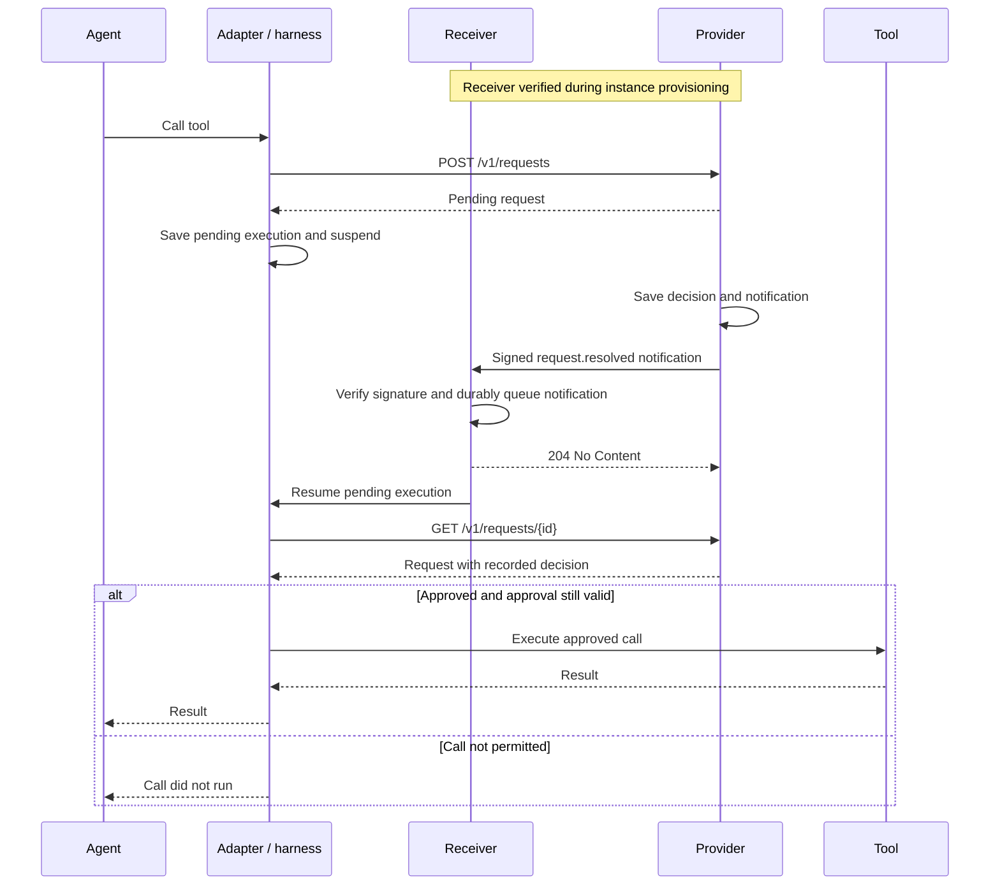

# Asynchronous Mode

In asynchronous mode, the harness suspends execution whilst waiting for approval.
It saves enough state to resume the intercepted tool call once a decision is available, so the agent process does not need to keep running.
This lets approvals outlive a process or a network connection.

The provider tells the harness about a decision by sending a webhook to a receiving service.
AAP version 1 uses webhooks for delivery, and a provider supporting asynchronous mode must support them.

## Flow



If the initial submission already returns a terminal request, the adapter applies it immediately and does not suspend.

## Delivery Configuration

The provisioner configures delivery when creating or updating an [instance](3_identity.md).
It supplies a `delivery` object with `type: webhook`, an HTTPS `url`, a `registration_id` and a `signing_secret`.
An instance without delivery configuration can only use synchronous mode.
Approval requests inherit the instance's configuration and cannot supply their own destination or secret.

The signing secret is 32 cryptographically random bytes, encoded as padded base64 with a `whsec_` prefix.
Each instance needs its own secret, and it must not be an instance credential or provisioner token.
The provider never returns the secret, and the agent must not receive it.
Instance responses expose only the receiver's type, URL and registration ID.

The registration ID is a UUID that the provisioner generates and associates with the secret on the receiving service before submitting it.
It lets the receiver select the right secret before it knows the provider's instance ID.
Reuse the registration ID when retrying the same submission, and generate a new one whenever delivery configuration is replaced.

The receiver may be part of the harness or a separate service.
It must be reachable by the provider and stay available whilst the agent process is stopped.

### Registration Example

A harness receives webhooks for several instances at `https://harness.example.com/aap/events`.
The provisioner generates a registration ID and signing secret, stores their association on the receiver, then submits:

```http
POST /v1/instances HTTP/1.1
Authorization: Bearer <provisioner_token>
Content-Type: application/json
Idempotency-Key: 673214be-26e4-44b2-8ef6-321df40fd265

{
  "instance_name": "codex-chris-laptop",
  "delivery": {
    "type": "webhook",
    "url": "https://harness.example.com/aap/events",
    "registration_id": "8246931c-4ce0-4c15-a94a-e9c078ad06e2",
    "signing_secret": "whsec_AAECAwQFBgcICQoLDA0ODxAREhMUFRYXGBkaGxwdHh8="
  }
}
```

The example secret is illustrative. A deployment must generate its own random secret.
The provider [verifies the receiver](#receiver-verification), then returns `201 Created` with the instance and its credential.

## Receiver Verification

Before creating an instance or replacing its delivery configuration, the provider sends a signed `WebhookVerification` to the proposed URL:

```json
{
  "id": "c9bb5281-f9a5-4660-b27e-0b1cbbad81b6",
  "type": "webhook.verification",
  "registration_id": "8246931c-4ce0-4c15-a94a-e9c078ad06e2",
  "instance_id": "b29a43a7-1949-4b9f-9d61-b7ae66f85d31",
  "created_at": "2026-09-16T11:59:00Z",
  "challenge": "2edc34d7-cc57-44b1-8705-2fa608d3224a"
}
```

The provider generates a fresh, unpredictable challenge for each configuration attempt and binds verification to the exact URL and proposed configuration.

The receiver uses `registration_id` to look up the secret and [verifies the signature](#signing).
It must check that it expects this registration, and must not automatically accept every registration from a recognised provider.
It then associates the proposed `instance_id` with the registration and returns `200 OK` with:

```json
{
  "challenge": "2edc34d7-cc57-44b1-8705-2fa608d3224a"
}
```

The challenge must match exactly and the response must arrive within ten seconds.
A bare `200` or a different `2xx` is not sufficient.
Later notifications carry only `instance_id`, which the receiver uses to select the secret.

The provider makes one verification attempt per creation or update attempt, without the notification retry schedule.
On failure, it returns `422` with code `webhook_verification_failed`.
A failed creation issues no instance or credential, and a failed update leaves the existing configuration and name unchanged.
The provisioner may retry with the same idempotency key and input, subject to the provider's registration limits.

## Updating and Removing Delivery

The provisioner replaces delivery configuration through [`PATCH /v1/instances/{id}`](5_http.md#update-an-instance).
It supplies the complete `delivery` object with a new registration ID, including when only rotating the secret.
The old configuration stays active until the replacement is verified and the update commits.
Setting `delivery` to `null` removes the receiver and ends outstanding delivery and retries.

After a replacement, queued notifications and future attempts go to the new URL with the new secret, including those for older requests.
Their IDs, bodies and retry deadlines stay the same, and completed deliveries are not replayed.
Attempts already in flight may still reach and be acknowledged by the old receiver, so the provisioner must coordinate the receiving services and their saved execution state during a move.

[Deleting the instance](5_http.md#delete-an-instance) ends delivery and retries and cancels its pending requests without sending notifications.
Attempts already in flight may still arrive.

## Notification

When a request becomes `approved`, `denied`, `expired` or `cancelled` and delivery is configured, the provider records one `RequestResolvedEvent`:

```json
{
  "id": "f4b96ac4-404d-4f6a-9a03-a0565edc4922",
  "type": "request.resolved",
  "instance_id": "b29a43a7-1949-4b9f-9d61-b7ae66f85d31",
  "request_id": "7ab8c8ec-7b2d-4fd6-9b52-752f9515eb71",
  "created_at": "2026-09-16T12:02:00Z"
}
```

`created_at` equals the decision's `decided_at`.
The event carries no outcome, tool arguments, credentials or permission to execute.
It only tells the receiver that a decision is available to read through the authenticated API.

The provider must record the event durably together with the decision, so that a restart cannot lose it.
This includes decisions made during request creation and ordinary cancellation.
Replaying or reading a request does not create another event, and adding a receiver does not create events for requests that were already terminal.
The event ID and body never change, across retries or receiver updates.
Notifications for different requests may arrive in any order.

The [OpenAPI schema](../../openapi.yaml) defines the event, verification objects and receiver operations.

### Delivery Example

This example continues the [registration example](#registration-example).
The adapter has submitted request `7ab8c8ec-7b2d-4fd6-9b52-752f9515eb71` as in the [synchronous example](6_sync.md#http-example), received `pending` and suspended.
A reviewer approves it at `12:02:00Z`, and the provider delivers the notification at `12:02:01Z`:

```http
POST /aap/events HTTP/1.1
Host: harness.example.com
Content-Type: application/json
webhook-id: f4b96ac4-404d-4f6a-9a03-a0565edc4922
webhook-timestamp: 1789560121
webhook-signature: v1,zgT2qt+QiEEonu9tmZqEuKzoa83SGE9ZcCgUHzqSPZ8=

{
  "id": "f4b96ac4-404d-4f6a-9a03-a0565edc4922",
  "type": "request.resolved",
  "instance_id": "b29a43a7-1949-4b9f-9d61-b7ae66f85d31",
  "request_id": "7ab8c8ec-7b2d-4fd6-9b52-752f9515eb71",
  "created_at": "2026-09-16T12:02:00Z"
}
```

The receiver verifies the signature and durably queues the notification before acknowledging it:

```http
HTTP/1.1 204 No Content
```

The adapter then retrieves the request with [`GET /v1/requests/{id}`](5_http.md#retrieve-a-request).
Its decision has `expires_at` set to `12:07:00Z`, so the saved call runs once if it can start before then.

## Signing

Verification messages and notifications use HTTPS `POST` with `Content-Type: application/json` and [Standard Webhooks' HMAC-SHA256 scheme](https://github.com/standard-webhooks/standard-webhooks/blob/main/spec/standard-webhooks.md#verifying-webhook-authenticity).

The required headers are:

| Header | Value |
| --- | --- |
| `webhook-id` | The message's `id`. |
| `webhook-timestamp` | The delivery attempt time in Unix seconds. |
| `webhook-signature` | `v1,` followed by the base64 HMAC digest. |

Remove `whsec_` and base64-decode the configured secret to obtain the signing key.
Sign `webhook-id`, `.`, `webhook-timestamp`, `.` and the exact transmitted body bytes, in that order, using UTF-8 for the header values and separators.
Do not parse and reserialize JSON before verification.
The header may contain space-separated signatures; a valid `v1` signature is required.
Each retry has a fresh attempt timestamp and signature.

The receiver must compare signatures in constant time, reject timestamps more than five minutes from its clock and check that the body ID matches `webhook-id`.
Notifications must match the instance bound during verification.
Providers and receivers must keep their clocks synchronized.
The provider never sends instance credentials or provisioner tokens to the receiver.

## Acknowledgements and Retries

The receiver verifies a notification and durably saves or queues it before returning any `2xx` response.
`204 No Content` is a suitable acknowledgement.
Acknowledgement confirms receipt, not that the tool call ran, and the provider ignores the response body.
A duplicate of an already saved notification also receives `2xx`.

The provider attempts delivery promptly and retries failures with exponential backoff and jitter for up to seven days after `decision.decided_at`, stopping once a delivery is acknowledged.
Each event has at most one attempt outstanding at a time.
Each attempt times out after at most ten seconds and must end by the retry deadline.
Connection failures, timeouts and non-`2xx` responses are failures.
The provider must not follow redirects, and must respect `Retry-After` on `429` and `503` responses without extending the retry window.

Delivery continues even if the approval itself has expired, because the receiver still needs to learn the request is terminal.
Delivery also extends how long the provider [retains the request](5_http.md#retention).

## Resuming Execution

Before suspending, the harness saves the approval request ID, the original idempotency key and the exact pending tool call.
A decision may arrive before suspension finishes, so the receiver must retain it so that the wake-up is not lost.

On resuming, the adapter must retrieve the current request from the provider rather than acting on the event.
It must check `decision.expires_at` immediately before the approved call starts, and must not run the call once that time has passed.

The same event may arrive more than once, and must never resume or execute the same call again.
The receiver must track event IDs through the retry window and delivery grace period; keeping them for eight days after `created_at` covers both.
The harness must also remember whether execution has started or been abandoned.
It acknowledges and discards a valid notification for abandoned execution without resuming it.

## Recovery

If an event is missed, the harness can retrieve its pending requests by their saved IDs.
The provider keeps decisions for the [required retention period](5_http.md#retention) whether or not delivery succeeded, but reading one still requires a valid credential, so this does not work after the instance is deleted.

If execution is abandoned, the adapter must attempt to cancel the pending request.
Suspending execution is not abandonment and must not cancel it.
