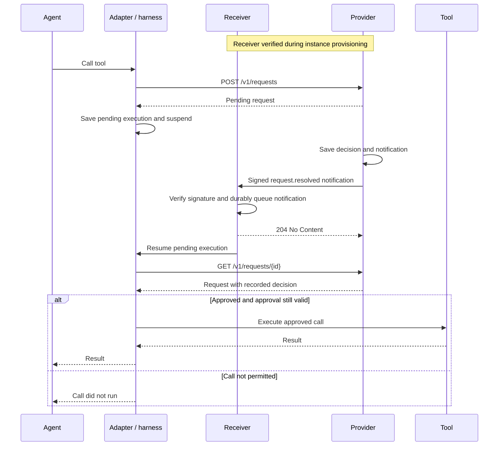

# Asynchronous Mode

In asynchronous mode, the harness saves the intercepted tool call and suspends execution whilst waiting for approval, so the agent process does not need to keep running.
This lets an approval outlive the agent process or its network connection, which suits approvals that may take hours or days.

When a decision is made, the provider sends a signed webhook to a receiver.
The receiver is an HTTPS endpoint, part of the harness or a separate service, that stays reachable whilst the agent is suspended.
It verifies and records the notification, then wakes the suspended execution, which fetches the decision and continues.

A provider supporting asynchronous mode must support webhook delivery.

## Flow



If the initial submission already returns a terminal request, the adapter applies it immediately and does not suspend.

## Delivery Configuration

The provisioner configures delivery when creating or updating an [instance](3_identity.md) by supplying a `delivery` object:

- `type`: always `webhook` in version 1.
- `url`: the receiver's HTTPS address.
- `registration_id`: a UUID the provisioner generates and stores with the secret on the receiver beforehand, so the receiver can find the secret before it knows the instance ID. Reuse it when retrying the same submission, and generate a new one for each replacement.
- `signing_secret`: 32 cryptographically random bytes, encoded as padded base64 with a `whsec_` prefix, separate for each instance. The provider never returns it, and it must be [kept from the agent](8_security.md#trust).

An instance without delivery configuration can only use synchronous mode.
Approval requests cannot override the instance's configuration.

### Registration Example

The provisioner stores a registration ID and secret on the receiver at `https://harness.example.com/aap/events`, then submits:

```http
POST /v1/instances HTTP/1.1
Authorization: Bearer <provisioner_token>
Content-Type: application/json
Idempotency-Key: 673214be-26e4-44b2-8ef6-321df40fd265

{
  "instance_name": "codex-chris-laptop",
  "delivery": {
    "type": "webhook",
    "url": "https://harness.example.com/aap/events",
    "registration_id": "8246931c-4ce0-4c15-a94a-e9c078ad06e2",
    "signing_secret": "whsec_AAECAwQFBgcICQoLDA0ODxAREhMUFRYXGBkaGxwdHh8="
  }
}
```

The example secret is illustrative.
The provider [verifies the receiver](#receiver-verification), then returns `201 Created` with the instance and its credential.

## Receiver Verification

Before creating an instance or replacing its delivery configuration, the provider sends a signed `WebhookVerification` to the proposed URL:

```json
{
  "id": "c9bb5281-f9a5-4660-b27e-0b1cbbad81b6",
  "type": "webhook.verification",
  "registration_id": "8246931c-4ce0-4c15-a94a-e9c078ad06e2",
  "instance_id": "b29a43a7-1949-4b9f-9d61-b7ae66f85d31",
  "created_at": "2026-09-16T11:59:00Z",
  "challenge": "2edc34d7-cc57-44b1-8705-2fa608d3224a"
}
```

The challenge is fresh and unpredictable for each attempt, and verification is bound to the exact URL and proposed configuration.

The receiver looks up the secret by `registration_id`, [verifies the signature](#signing) and checks that it expects this registration.
It must not accept every registration from a recognised provider.
It then stores the `instance_id`, which later notifications use to identify the secret, and returns `200 OK` with:

```json
{
  "challenge": "2edc34d7-cc57-44b1-8705-2fa608d3224a"
}
```

The challenge must match exactly within ten seconds; any other response fails.
The provider makes one attempt and does not retry.
On failure, it returns `422` with code `webhook_verification_failed`: no instance is created, or an update leaves the existing configuration and name unchanged.
The provisioner may retry with the same idempotency key and input, subject to the provider's registration limits.

## Updating and Removing Delivery

The provisioner replaces delivery configuration through [`PATCH /v1/instances/{id}`](5_http.md#update-an-instance) with a complete `delivery` object and a new registration ID, including when only rotating the secret.
The old configuration stays active until the replacement is verified.
Setting `delivery` to `null` removes the receiver and stops delivery.

After a replacement, undelivered notifications go to the new receiver with unchanged IDs, bodies and retry deadlines.
Completed deliveries are not replayed.
An attempt already in flight may still reach the old receiver, so the provisioner must coordinate both receivers and their saved execution state during a move.

[Deleting the instance](5_http.md#delete-an-instance) stops delivery and cancels its pending requests without notifications.

## Notification

When a request becomes `approved`, `denied`, `expired` or `cancelled` and delivery is configured, the provider records one `RequestResolvedEvent`:

```json
{
  "id": "f4b96ac4-404d-4f6a-9a03-a0565edc4922",
  "type": "request.resolved",
  "instance_id": "b29a43a7-1949-4b9f-9d61-b7ae66f85d31",
  "request_id": "7ab8c8ec-7b2d-4fd6-9b52-752f9515eb71",
  "created_at": "2026-09-16T12:02:00Z"
}
```

`created_at` equals the decision's `decided_at`.
The event carries no outcome, tool arguments, credentials or permission to execute.

The provider must record the event durably together with the decision, including decisions made at creation or by cancellation.
Reading or replaying a request creates no event, and adding a receiver creates none for requests that were already terminal.
The event ID and body never change.
Notifications for different requests may arrive in any order.

The [OpenAPI schema](../../openapi.yaml) defines the event, verification objects and receiver operations.

### Delivery Example

The adapter has submitted the request from the [synchronous example](6_sync.md#http-example) and suspended.
It is approved at `12:02:00Z`, and the provider notifies the [registered receiver](#registration-example) at `12:02:01Z`:

```http
POST /aap/events HTTP/1.1
Host: harness.example.com
Content-Type: application/json
webhook-id: f4b96ac4-404d-4f6a-9a03-a0565edc4922
webhook-timestamp: 1789560121
webhook-signature: v1,zgT2qt+QiEEonu9tmZqEuKzoa83SGE9ZcCgUHzqSPZ8=

{
  "id": "f4b96ac4-404d-4f6a-9a03-a0565edc4922",
  "type": "request.resolved",
  "instance_id": "b29a43a7-1949-4b9f-9d61-b7ae66f85d31",
  "request_id": "7ab8c8ec-7b2d-4fd6-9b52-752f9515eb71",
  "created_at": "2026-09-16T12:02:00Z"
}
```

The receiver verifies the signature and durably queues the notification before acknowledging it:

```http
HTTP/1.1 204 No Content
```

The adapter then [retrieves the request](5_http.md#retrieve-a-request).
Its decision expires at `12:07:00Z`, so the saved call must start before then.

## Signing

Verification messages and notifications use HTTPS `POST` with `Content-Type: application/json` and [Standard Webhooks' HMAC-SHA256 scheme](https://github.com/standard-webhooks/standard-webhooks/blob/main/spec/standard-webhooks.md#verifying-webhook-authenticity).

The required headers are:

| Header | Value |
| --- | --- |
| `webhook-id` | The message's `id`. |
| `webhook-timestamp` | The delivery attempt time in Unix seconds. |
| `webhook-signature` | `v1,` followed by the base64 HMAC digest. |

The signing key is the configured secret without `whsec_`, base64-decoded.
Sign `webhook-id`, `.`, `webhook-timestamp`, `.` and the exact transmitted body bytes, in that order, using UTF-8 for the header values and separators.
Do not parse and reserialize JSON before verification.
The header may contain space-separated signatures; a valid `v1` signature is required.
Each retry is signed again with a fresh timestamp.

The receiver must compare signatures in constant time, reject timestamps more than five minutes from its clock, check that the body ID matches `webhook-id` and check that notifications match the instance bound during verification.
Providers and receivers must keep their clocks synchronized.
The provider never sends instance credentials or provisioner tokens to the receiver.

## Acknowledgements and Retries

The receiver verifies a notification and durably saves it before returning any `2xx`, such as `204 No Content`.
Acknowledgement confirms receipt only, and the provider ignores the response body.
Duplicates of a saved notification also receive `2xx`.

The provider delivers promptly and retries failures with exponential backoff and jitter until acknowledged, for up to seven days after `decision.decided_at`.
Each event has at most one attempt outstanding, and each attempt times out within ten seconds and ends by the retry deadline.
Connection failures, timeouts and non-`2xx` responses are failures.
The provider must not follow redirects, and must respect `Retry-After` on `429` and `503` without extending the retry window.

Delivery continues after the approval expires, and extends how long the provider [retains the request](5_http.md#retention).

## Resuming Execution

Before suspending, the harness saves the approval request ID, the original idempotency key and the exact pending tool call.
The receiver must keep a notification that arrives before suspension finishes.

On resuming, the adapter must retrieve the request rather than act on the event, and check `decision.expires_at` immediately before the call starts.

A repeated event must never resume or execute the same call again.
The receiver must keep event IDs for at least eight days after `created_at`, which covers the retry window and delivery grace period.
The harness must remember whether execution has started or been abandoned, and acknowledge but discard notifications for abandoned execution.

## Recovery

If an event is missed, the harness can retrieve its pending requests by their saved IDs.
Decisions remain readable for the [retention period](5_http.md#retention) whether or not delivery succeeded, but only with a valid credential.

If execution is abandoned, the adapter must attempt to cancel the pending request.
Suspending execution is not abandonment and must not cancel it.
